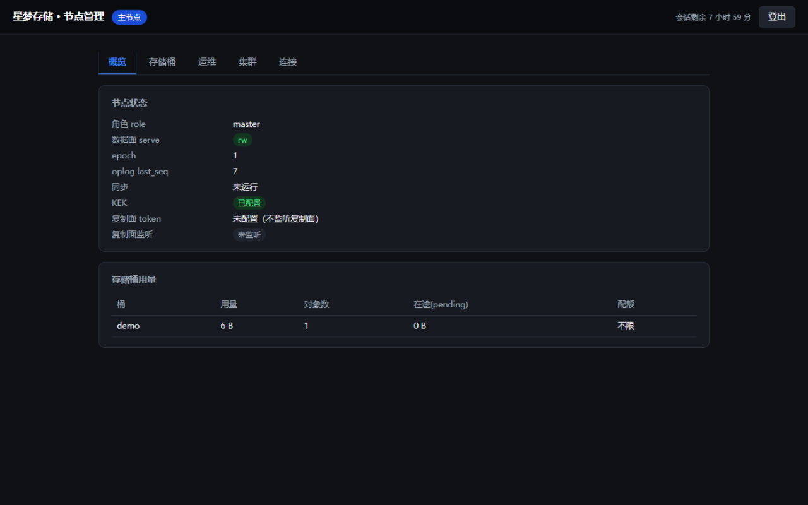
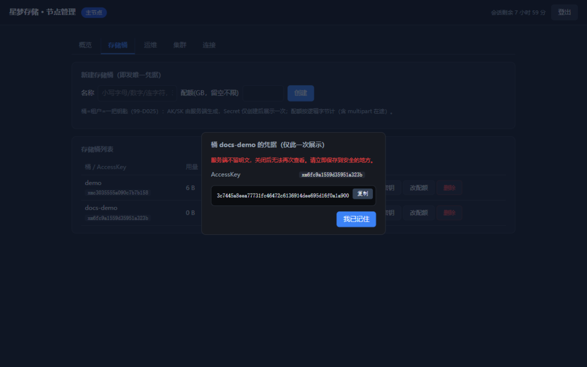
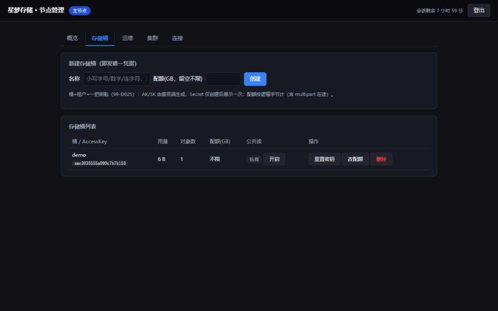
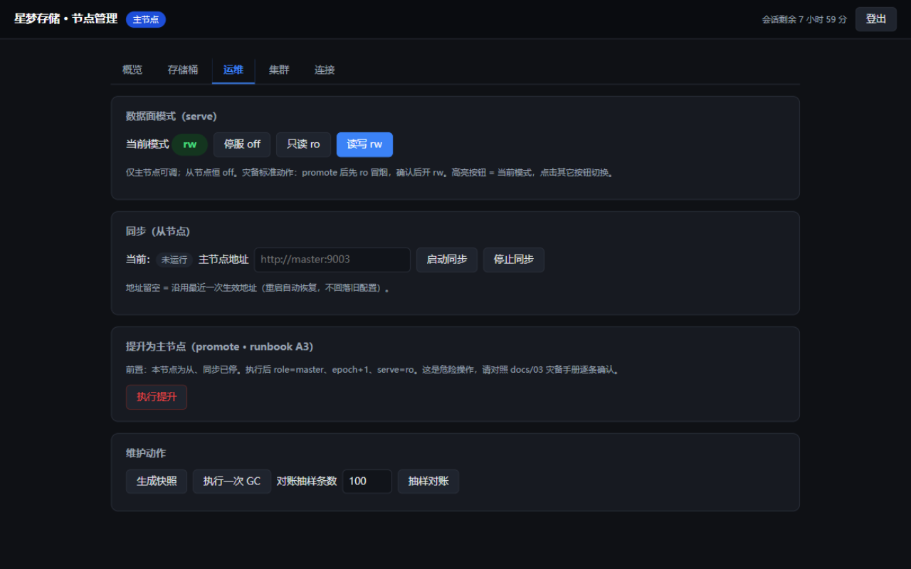
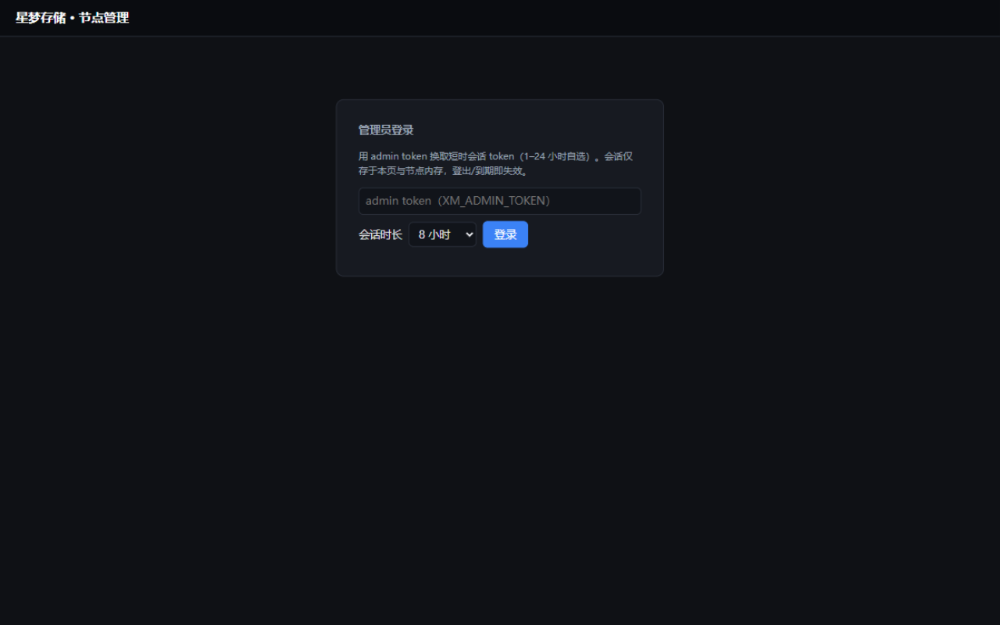

# 星梦存储（xmd）

Go 实现的**单二进制自建存储服务**：一个进程同时提供 **S3 / SFTP / WebDAV** 三种协议、内置管理 WebUI、主从异步复制与灾备切换。面向需要"自己拥有一块对象存储"的业务平台与个人——不做多租户平台，只做一块干净、可靠、可审计的存储地基。

```bash
docker run -d -p 9000:9000 -p 9001:9001 -p 127.0.0.1:9002:9002 \
  -v xmd-data:/var/lib/xmd \
  -e XM_KEK=<长随机串> -e XM_ADMIN_TOKEN=<长随机串> \
  xmd:latest
# 浏览器打开 http://127.0.0.1:9002 —— 建桶即发钥，一分钟上手
```

## 特性

- **三协议共享一个命名空间**：S3（SigV4 签名、presigned URL、multipart、ListV2）为主接口；SFTP（用户名/密码即 AK/SK，登录即以桶为根目录）服务人工备份；WebDAV（`/dav/<bucket>`）顺带提供。mc / aws-cli / rclone / WinSCP / rsync 开箱即用。
- **桶 = 租户 = 一把钥匙**：建桶即由服务端生成 AK/SK（Secret 仅展示一次，AES-GCM 密封落库）；删桶级联删钥；一个桶至多一把钥匙。重置/冻结走桶级 rotate。
- **数据安全优先的存储内核**：内容寻址（SHA-256）数据面，fsync 后原子入库；SQLite（WAL + FULL）元数据与配额/oplog 同事务零漂移；两阶段 GC 清扫前重验存活；流式配额守卫防"写满磁盘才拒绝"；抽样对账命令随时核验磁盘位翻转。
- **主从异步复制 + 手动灾备**：oplog 全量状态 op + epoch fencing 防旧主复活；快照 + 追赶的从节点引导；promote 护栏与 runbook 化切换（先 ro 冒烟再开 rw）。
- **管理面**：单页暗色 WebUI（状态/桶与凭据/serve 开关/同步/promote/GC/对账/连接片段生成）+ admin API（双 token 会话、审计日志）+ Prometheus 指标。
- **可选公共读面**：按桶开关的独立只读端口（:9004），同构 404 防枚举，配合你的反代做文件分发；写与列举永远需要凭据。

| 监听面 | 默认端口 | 协议 / 内容 | 鉴权 |
|---|---|---|---|
| 数据面 HTTP | :9000 | S3（path-style）+ WebDAV（`/dav/<bucket>`） | SigV4 / Basic（凭据绑桶） |
| 数据面 SSH | :9001 | SFTP | SSH 密码 = AK/SK |
| 管理面 | :9002 | admin API + WebUI + Prometheus | admin token / 短时会话 |
| 复制面 | :9003 | repl API（主从） | repl token（空 = 不监听） |
| 公共读面 | :9004 | 匿名只读直链（仅公共桶） | 无（只认桶公共标志） |

## 管理页速览

| 概览 | 建桶即发钥（Secret 仅此一次） |
|---|---|
|  |  |

| 桶与凭据同页管理 | 运维（serve / 同步 / promote / GC / 对账） |
|---|---|
|  |  |

登录页用 admin token 换 1–24 小时短时会话，浏览器不长期持有长期凭证：



## 快速开始（单节点）

1. 构建镜像（先交叉编译再打包，见 [xingmeng/README.md](xingmeng/README.md)）或使用你自己的构建流水线；
2. `docker run` 如上（`XM_KEK` 与 `XM_ADMIN_TOKEN` 必填，≥16 字符高熵随机串）；
3. 打开管理页建桶：响应/弹窗一次性给出 AK/SK，立刻保存；
4. 客户端直连 ：9000：

```bash
mc alias set xm http://127.0.0.1:9000 <AK> <SK>
mc cp ./file.bin xm/mybucket/
```

集群（1 主 N 从异地备份）与全部环境变量、YAML 项、安全基线见 **[docs/05-部署与配置](docs/05-部署与配置.md)**。

## 安全模型（务必阅读）

- **传输安全由部署层提供**：数据面/公共读面对外请经 TLS 反代或隧道（WebDAV Basic 会明文传输 SK）；admin/repl 面不进公网。详见 [docs/05 安全基线](docs/05-部署与配置.md)。
- 凭据 Secret 以 AES-256-GCM（KEK 来自环境变量）密封落库，服务端不存明文；KEK 丢失走逐桶 rotate 恢复。
- 桶级凭据即全部授权模型（有意不做 IAM/ACL/policy——保持简单可审计）；每桶可设逻辑字节配额。
- 数据目录自包含（`meta.db` + 内容寻址 blob），整目录即备份单元。

## 文档

设计即文档——本仓库的开发流程以 `docs/` 为"开工宪法"（代码与文档冲突时先改文档）：

- [01 产品定义与边界](docs/01-产品定义与边界.md) · [02 存储层设计](docs/02-存储层设计.md) · [03 复制与灾备](docs/03-复制与灾备.md)
- [04 接口定义](docs/04-接口定义.md) · [05 部署与配置](docs/05-部署与配置.md) · [06 测试清单](docs/06-测试清单.md)
- [99 决策记录（ADR）](docs/99-决策记录.md) —— 每条设计决策的理由与被否方案
- [xingmeng/README.md](xingmeng/README.md) —— 分包结构与开发指南

## 开发

```bash
cd xingmeng
go vet ./...
go test ./...
```

e2e（真容器 1 主 1 从 + mc/rclone 三协议 + 灾备切换）：`xingmeng/e2e/run.sh`。

## License

[Apache-2.0](LICENSE)
